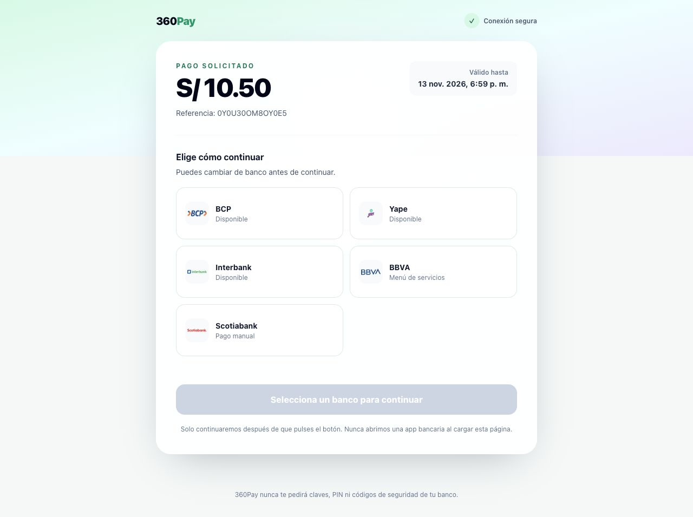
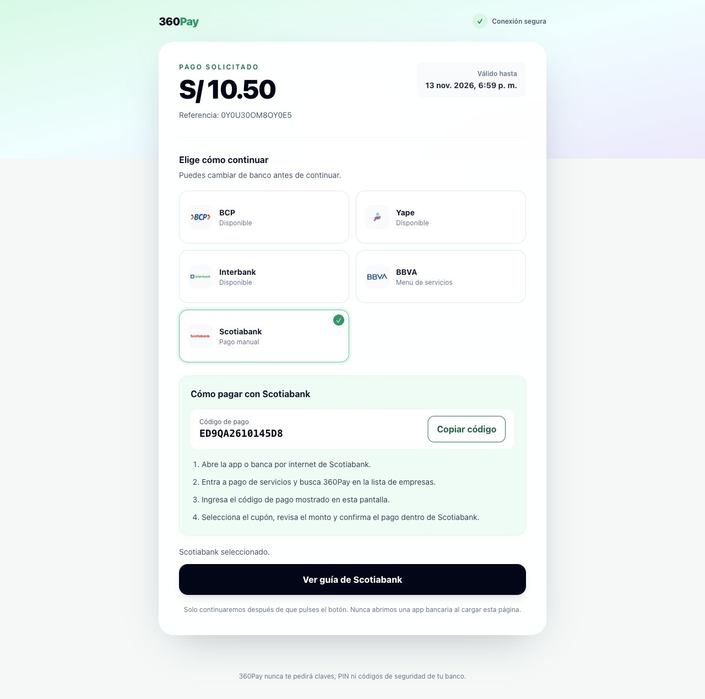

# 360Pay · ejemplo de integración en sandbox

Un servidor Node.js y una página HTML para **crear un cupón por API**, consultar
su estado y utilizar `payment_url` o `bank_deeplinks`. No requiere instalar
dependencias, framework, base de datos ni desplegar una aplicación.

La API key se utiliza únicamente desde el servidor. El navegador recibe el
cupón y sus enlaces, nunca la credencial. Este ejemplo usa la API de clientes
`/v1`.

## Preparación

Necesitas Node.js 22 o posterior y estos recursos **de sandbox**:

- API key `pk_test_…` con `payment_coupons:write` y `payment_coupons:read`.
- Business activo y Workspace autorizado por la credencial, con Payments
  habilitado y el entitlement operativo.
- Prefijo de recaudo asignado al negocio; no uses el prefijo ficticio de la
  documentación para un negocio distinto.

```bash
cp .env.example .env
```

Completa `STUDIO_API_KEY`, `STUDIO_WORKSPACE_ID` y `STUDIO_PAYMENT_PREFIX` en
`.env`. Las credenciales se administran en la sección de API keys de Client.
Si ya tienes una clave autorizada, úsala. Un secreto existente no puede
recuperarse desde el listado: se muestra al crear o rotar la credencial.

```bash
npm start
```

Abre **http://localhost:3000**. El servidor escucha únicamente en la interfaz
local. Si el puerto está ocupado, cambia `PORT` en `.env` y reinicia. También
puedes iniciar con las variables ya exportadas usando `node server.mjs`.

La URL de API está fijada a `https://sandbox.api.360studio.app/v1`. El ejemplo
rechaza claves productivas. Nunca compartas `.env`, pantallas con credenciales
ni datos personales. Usa tu negocio de sandbox y los datos ficticios del formulario.

## Crear y consultar

1. El formulario prepara nombre, importe en PEN, código, descripción, referencia
   y vencimiento. El código debe comenzar con el prefijo del negocio y tener
   hasta 14 caracteres alfanuméricos.
2. **Crear cupón en sandbox** envía `POST /v1/payment-coupons` con
   `Authorization: Bearer <API_KEY_SANDBOX>` y `x-workspace-id`.
3. No necesitas crear previamente un contacto. El código busca uno en el
   negocio; si no existe, se crea con el nombre enviado. Un contacto existente
   se reutiliza sin cambiar su nombre.
4. `201` significa cupón creado. Repetir exactamente el cobro con el mismo
   `external_ref` devuelve `200` con `meta.idempotent_replay=true`. Cambiar sus
   datos conservando esa referencia devuelve `409`.
5. **Consultar estado del cupón** usa `GET /v1/payment-coupons/{id}`. La API de
   clientes devuelve `id`, no `_id`.
6. **Preparar otro cobro** genera otra referencia. No pulses este botón para
   recuperar una creación cuyo resultado se perdió.

`external_ref` identifica el cobro dentro del Workspace. `payment_coupon_code`
es el código que usa el cliente en el banco; `payment_reference` es otra
referencia bancaria generada por el sistema. No los intercambies.

`expiry_date` es obligatoria. Los cupones nuevos de esta API tienen
`expiry_policy=informational`: esa fecha se muestra, pero el cupón activo puede
seguir siendo pagable después. Los cupones históricos pueden conservar
`enforced`. Pago, anulación, revocación o desactivación pueden bloquear el acceso.

### Workspace en la API de clientes

La API key identifica al negocio y limita los Workspaces autorizados. En la
API de clientes el header selecciona en cuál de ellos se crea el cupón.

Se configura **una vez en el backend** mediante `STUDIO_WORKSPACE_ID`; no se
solicita a la persona que va a pagar. Cada petición lleva un scope explícito:
el binding de la clave autoriza el acceso, pero no selecciona automáticamente
un Workspace, incluso cuando solo autoriza uno. Esto mantiene la creación y
las consultas del cobro dentro del mismo negocio y Workspace.

`POST /v1/payment-coupons` requiere el header **`x-workspace-id`**, incluso
con un único Workspace autorizado. El body no acepta `workspace_id`.

Por eso este ejemplo exige `STUDIO_WORKSPACE_ID` en `.env` y lo envía como
header. La propiedad `data.workspace_id` de la respuesta indica dónde quedó
el cupón; no sustituye el header de la solicitud.

Si omites el header, la API responde HTTP **400** con
`A valid x-workspace-id header is required`. Consulta el contrato en el
[OpenAPI de clientes](https://sandbox.api.360studio.app/docs/json/api).

### Ejemplo cURL directo a sandbox

Guarda el cuerpo en `coupon.json`, sustituyendo el prefijo por el del negocio y
la fecha por una fecha válida para tu prueba:

```json
{
  "customer_name": "Cliente Demo",
  "payment_coupon_code": "ACA000042",
  "amount": 10.5,
  "currency": "PEN",
  "external_ref": "DEMO-COBRO-001",
  "description": "Cuota de demostración",
  "expiry_date": "2030-10-31T23:59:59.000Z"
}
```

Carga las variables desde tu archivo local y ejecuta sin activar trazas de shell
ni el modo verbose de cURL:

```bash
set -a
. ./.env
set +a
curl --silent --show-error --fail-with-body \
  'https://sandbox.api.360studio.app/v1/payment-coupons' \
  --header "Authorization: Bearer $STUDIO_API_KEY" \
  --header "x-workspace-id: $STUDIO_WORKSPACE_ID" \
  --header 'Content-Type: application/json' \
  --data-binary @coupon.json
```

Para consultar, sustituye `<ID_DEL_CUPON>` por `data.id`:

```bash
curl --silent --show-error --fail-with-body \
  'https://sandbox.api.360studio.app/v1/payment-coupons/<ID_DEL_CUPON>' \
  --header "Authorization: Bearer $STUDIO_API_KEY" \
  --header "x-workspace-id: $STUDIO_WORKSPACE_ID"
```

## Respuesta al crear el cupón

HTTP **201 Created** devuelve `{ success, data, meta }`. Este es un extracto
ilustrativo con IDs y token ficticios; los enlaces del ejemplo no son operativos:

```json
{
  "success": true,
  "data": {
    "id": "507f1f77bcf86cd799439011",
    "workspace_id": "507f1f77bcf86cd799439013",
    "amount": 10.5,
    "currency": "PEN",
    "status": "active",
    "external_ref": "DEMO-COBRO-001",
    "payment_coupon_code": "ACA000042",
    "payment_reference": "DEMOREF000042",
    "payment_url": "https://360pay-site.web.app/p/TOKEN_DEMO_NO_OPERATIVO_000042",
    "bank_deeplinks": {
      "bcp": "https://360pay-site.web.app/l/TOKEN_DEMO_NO_OPERATIVO_000042/bcp",
      "yape": "https://360pay-site.web.app/l/TOKEN_DEMO_NO_OPERATIVO_000042/yape",
      "interbank": "https://360pay-site.web.app/l/TOKEN_DEMO_NO_OPERATIVO_000042/interbank",
      "bbva": "https://360pay-site.web.app/l/TOKEN_DEMO_NO_OPERATIVO_000042/bbva",
      "scotiabank": null
    }
  },
  "meta": { "idempotent_replay": false }
}
```

El [JSON completo de creación](examples/coupon-created.response.json) incluye
el contacto, `expiry_policy` y las fechas. Repetir el mismo cobro devuelve
HTTP **200** con el mismo `data.id` y enlaces, y
`meta.idempotent_replay=true`: [ejemplo de replay](examples/coupon-replayed.response.json).

## Caso A: `payment_url`

El campo `data.payment_url` abre la pantalla de 360Pay. El cliente ve el código,
el importe, el estado y las opciones del catálogo; elige banco y sigue sus
instrucciones. Es el enlace adecuado para compartir una experiencia con todas
las alternativas.

```js
// Dentro del navegador: asignar el valor completo recibido, sin reconstruirlo.
paymentButton.href = response.data.payment_url;
paymentButton.target = '_blank';
paymentButton.rel = 'noopener noreferrer';
```

## Caso B: `bank_deeplinks`

Cada valor no nulo de `data.bank_deeplinks` es una URL HTTPS durable de 360Pay
con ruta `/l/<token>/<banco>`. Su apertura valida el cupón y devuelve un `302`
al destino bancario. Usa ese valor completo, sin añadir parámetros, cambiar el
dominio ni construir una URL desde el ID o código del cupón.

Úsalos desde un **celular con la app bancaria instalada**. Para Yape, BCP e
Interbank, el deeplink abre directamente la sección de pago de 360Pay con el
código del cupón precargado. La app recupera el cupón y su importe para que el
cliente revise y confirme el pago, **sin escribir el código ni el monto**.

| Banco | Comportamiento |
| --- | --- |
| Yape | Abre la app en pago de 360Pay con el código precargado; revisar y confirmar el importe del cupón. |
| BCP | Abre la app en pago de 360Pay con el código precargado; revisar y confirmar el importe del cupón. |
| Interbank | Abre la app en pago de 360Pay con el código precargado; revisar y confirmar el importe del cupón. |
| BBVA | Abre un menú genérico; seleccionar 360Pay e ingresar el código. |
| Scotiabank | Devuelve `null`; usar la guía manual en `payment_url`. |

```js
const url = response.data.bank_deeplinks.yape;
if (url) {
  yapeButton.href = url;
  yapeButton.target = '_blank';
  yapeButton.rel = 'noopener noreferrer';
}
```

Los botones del ejemplo admiten solamente `https://360pay-site.web.app` y las
rutas del contrato. Si sandbox devuelve otro origin, la respuesta se muestra y
los enlaces afectados se bloquean para revisar la configuración del ambiente.
Los ejemplos del OpenAPI pueden mostrar el dominio productivo y tokens
ficticios: utiliza siempre los valores de tu respuesta real.

Sandbox corresponde a la API y la web 360Pay. Los destinos siguen siendo apps o
webs bancarias reales; detén la demo antes de confirmar un pago. El HTTP `302`
demuestra entrega del destino, no apertura de una app ni confirmación del pago.
Para el estado final consulta la API o incorpora el webhook `PAYMENT_PAID`
descrito a continuación.

## Webhook de pago confirmado

Configura un hook **PAYMENT_PAID** desde **Client > Administración >
Integraciones > API y webhooks > Webhooks**, con un usuario autorizado.
La configuración pertenece al negocio y recibe eventos de sus Workspaces.
La API pública `/v1` de este ejemplo se utiliza para emitir y consultar cupones;
la administración de webhooks se realiza desde el panel.

1. Pulsa **Nuevo webhook** y selecciona **Pago confirmado**.
2. Ingresa la URL HTTPS pública de tu backend receptor.
3. Para recibir el payload estándar, incluye los campos originales y deja vacíos
   el mapping y los campos adicionales.
4. Guarda el webhook y copia el secreto completo que muestra Client.

### Obtener el secreto HMAC

**El secreto para verificar HMAC se obtiene al guardar el webhook en Client.**
El panel lo muestra completo una sola vez. Guárdalo en la configuración privada
del backend receptor, por ejemplo como `STUDIO_WEBHOOK_SIGNING_SECRET`, que se
pasa al verificador de este repositorio.

El secreto del hook es distinto de la API key `pk_test_…`. No lo incluyas en el
frontend de tu integración ni lo guardes en Git. Al consultar el webhook, la
vista parcial del secreto sirve para reconocerlo, pero **no permite verificar
HMAC**. Si perdiste el valor completo, rótalo desde el panel.

### Rotar el secreto HMAC

En la pestaña **Webhooks** de Client, abre el webhook y pulsa **Rotar secreto**.
Confirma la operación, copia el nuevo secreto que se muestra una sola vez y
actualiza la configuración privada de tu backend receptor para ese mismo hook.

Las entregas nuevas usan el secreto nuevo. Las ya encoladas y sus reintentos
conservan el anterior: coordina la transición del receptor y el retiro del
secreto anterior cuando se resuelvan esas entregas pendientes.

### Evento de pago

El tipo del hook es `PAYMENT_PAID`, mientras que el campo `event` del body es
**`payment_coupon.paid`**. Ejemplo ilustrativo del payload estándar, sin mappings:

```json
{
  "event": "payment_coupon.paid",
  "version": 1,
  "occurred_at": "2030-10-14T15:30:00.000Z",
  "data": {
    "payment_coupon_id": "507f1f77bcf86cd799439011",
    "payment_reference": "DEMOREF000042",
    "external_ref": "DEMO-COBRO-001",
    "amount": 10.5,
    "currency": "PEN",
    "paid_at": "2030-10-14T15:30:00.000Z"
  }
}
```

Busca el cobro guardado por `data.payment_coupon_id`, que corresponde a `data.id`
de la creación. Ese registro debe conservar el Business y el Workspace del cupón.
`external_ref` es único dentro del Workspace y puede repetirse en otros: úsalo
como comprobación adicional dentro del Workspace resuelto, no como clave global.
El payload estándar de pago no incluye `workspace_id`. El ID de evento llega en
`X-360Studio-Event-Id`, no como campo del JSON.

La firma llega en `X-360Studio-Signature`, con formato `sha256=<hex>`. Se calcula
con HMAC-SHA256 sobre **`timestamp + "." + body original`**. Usa los bytes recibidos
y `X-360Studio-Timestamp`, sin parsear y volver a serializar el JSON para verificar.

El [verificador Node.js](examples/verify-webhook-signature.mjs) implementa ese
contrato, compara la firma en tiempo constante y aplica una ventana de 5 minutos:

```js
import { verify360StudioWebhook } from './examples/verify-webhook-signature.mjs';

// rawBody es el Buffer original recibido. req.headers usa nombres en minúsculas.
const valid = verify360StudioWebhook(
  rawBody,
  req.headers,
  process.env.STUDIO_WEBHOOK_SIGNING_SECRET
);
```

Rechaza la petición con HTTP **401** si `valid` es `false`, antes de procesar el
evento. El secreto se usa como texto UTF-8, no se decodifica como hexadecimal.
Puedes ejecutar una demostración local sin credenciales ni llamadas de red:

```bash
npm run demo:webhook
```

La demostración firma el fixture con un secreto ficticio y un timestamp actual,
verifica el body original y demuestra que un body alterado se rechaza. En el
receptor real, usa siempre el timestamp recibido y su propio `signing_secret`.

Si tienes varios hooks, usa `X-360Studio-Webhook-Id` para buscar el secreto
correspondiente en tu backend. El verificador autentica el body; tu receptor
también valida el tipo, versión y campos del evento antes de aplicarlo.

Guarda `X-360Studio-Event-Id` y el evento de forma durable. Procesa cada evento
una vez y responde rápidamente con **2xx** cuando hayas persistido el evento
o completado su procesamiento. Si ya lo procesaste, responde **200** sin repetir
efectos. Una respuesta posible de tu endpoint es `200 OK` con `{ "received": true }`.
El body de esa confirmación lo define tu backend.

360Studio realiza un intento inicial y hasta **3 reintentos** ante errores,
timeouts o respuestas fuera de 2xx. El evento puede llegar varias veces. No
uses el número de intento como estado del cupón ni dedupliques solo en memoria.

Consulta los [headers, fixtures y alcance del ejemplo](examples/README.md) y la
[guía oficial de webhooks de sandbox](https://sandbox.api.360studio.app/docs/webhooks).
Los fixtures usan datos ficticios y permiten probar el verificador localmente.
El servidor local de emisión no expone un receptor público: incorpora el
verificador y la persistencia en tu propio backend.

## Errores y reintentos

| HTTP | Qué revisar |
| --- | --- |
| 400 | Cuerpo, código/prefijo o header de Workspace. |
| 401 | Clave de sandbox válida y header Bearer. |
| 403 | Scopes, binding, Business, Workspace, tool y entitlement. |
| 404 | Cupón fuera del scope o recurso inexistente. |
| 409 | Referencia reutilizada con otros datos o cupón/banco no disponible. |
| 410 | Enlace revocado. |
| 429 | Esperar antes de reintentar, conservando referencia y cuerpo. |
| 502 / timeout local | La creación pudo completarse; reintentar el mismo cobro. |
| 503 local | Completar `.env` y reiniciar el servidor. |

No se hacen reintentos automáticos ni se confirma un pago desde este servidor.

## Verificación y capturas

La [presentación para clientes](presentation/README.md) reúne las explicaciones
del ejemplo y las tres capturas reales de 360Pay, en PDF.

```bash
npm run check
npm test
```

Las pruebas ejercitan HTTP contra un upstream local controlado: forwarding de
headers y referencia, estados/respuestas, ausencia de credenciales en el
navegador, rechazo de otro origen y errores. No certifican sandbox ni bancos.

Consulta la [guía para comprobar tu integración](docs/VALIDATION.md) y las
[capturas de la página de pago](docs/screenshots/README.md). Los importes,
códigos y referencias de las imágenes son datos de demostración. Crea tus
propios cupones para obtener enlaces utilizables en tus pruebas.





Referencia: [API de sandbox](https://sandbox.api.360studio.app/docs/api),
[OpenAPI de clientes](https://sandbox.api.360studio.app/docs/json/api) y
[contrato público de enlaces](https://sandbox.api.360studio.app/docs/json/payments-public).
